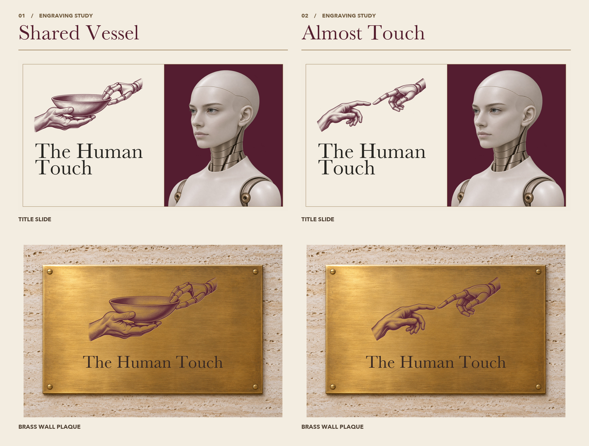

# Almost Touch / Shared Vessel

[Keynote](Engraving%20comparison.key) · [PowerPoint](Engraving%20comparison.pptx) · [Shared Vessel originals](../README.md) · [Pitch handoff](../../HANDOFF.md)

**Almost Touch** quotes the opening fresco: the human index extends from the left; Emmy answers from the right. The narrow gap must remain empty and visible when projected. **Shared Vessel** shows a different idea: the human carries the weight and Emmy steadies the rim. Both remain candidates. The two applications keep the original palette, typography, portrait, and plaque photograph fixed.

The first two slides compare both applications. Slides 3 and 4 are full-size title treatments with independently editable emblems, titles, and portraits. To iterate, edit a copy of slide 4 and replace only the emblem. The dark engraved linework on the plaque is a material mockup; confirm the finest hatching with a physical sample before fabrication.

| Asset | Use |
| --- | --- |
| [Engraving master](engraving-master.png) and [Imagegen prompt](imagegen-prompt.txt) | Source for another drawing; use the [original Shared Vessel master](../engraving-master.png) as the style reference. |
| [Velvet](velvet.png), [ink](ink.png), [ivory](ivory.png) | Transparent single-color impressions. Velvet is the review color. |
| [Single-ink SVG](engraving.svg) | Scalable contours for print tests. |
| [Title](title.jpg) and [plaque](plaque.jpg) | Full-size application proofs. The [blank brass specimen](../../logo-review/art/brass-blank.png) is reusable. |
