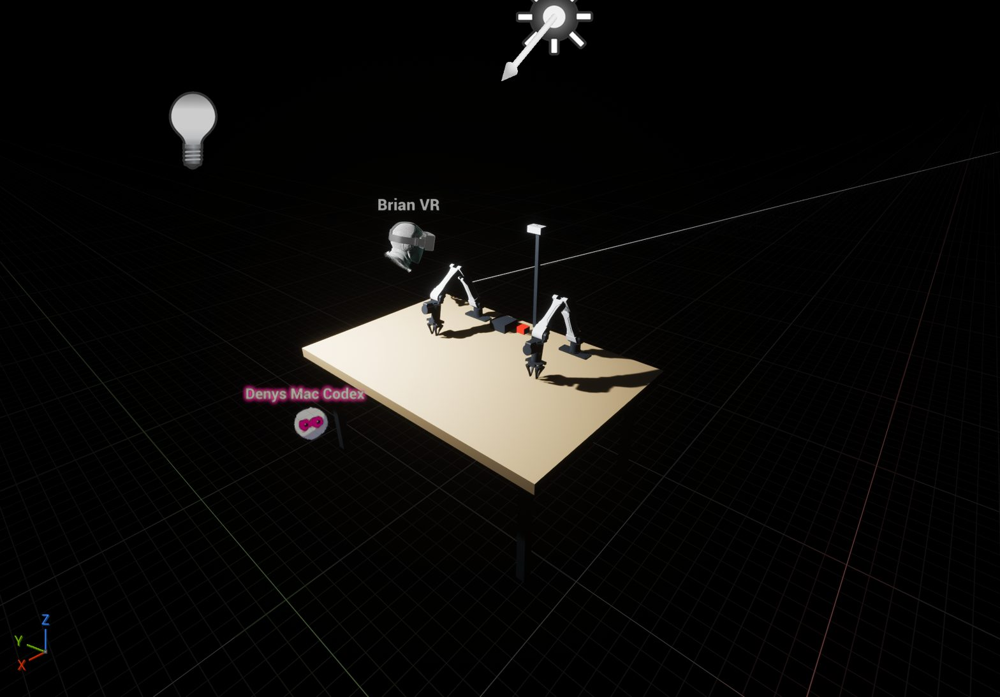

# Dreamlabs / YAM simulation research

Researched November 7, 2026. The user supplied two photos of a tabletop bimanual station and requested adding the robots to TheHumanTouch.

## Identification and sources

Dream Labs supplies Dream-1, a robot policy service. Its [homepage](https://dreamlabs.ai/) explicitly describes a bimanual YAM embodiment and an interface taking camera images, robot state and a task, then returning actions. The photos are visually consistent with a pair of I2RT YAM arms: white link covers, black joints, parallel grippers, tabletop mounts and a central camera mast. This is a working identification, not confirmation of the precise hardware revision. Camera models, optical calibration, arm spacing and table dimensions cannot be established from these photographs alone.

The [official I2RT repository](https://github.com/i2rt-robotics/i2rt) provides URDF, meshes, Python control and MuJoCo support. We selected the standard six-axis YAM v1 model, not the newer seven-axis variants. Its URDF includes six revolute joints plus two opposed prismatic finger joints. The fingers are driven together by this preview's single displacement argument. Upstream effort/velocity fields are not treated as measured actuator limits.

The [Dream-1 launch article](https://dreamlabs.ai/research/dream-1/) describes bimanual parallel-gripper use and a client flow using `DreamClient`, `policy`, `set_observation` and `get_action`. These are vendor claims; no task-success or latency measurement was made here. The [official package page](https://pypi.org/project/dreamlabs/1.0.5/) distinguishes the full station CLI from the standalone policy client, `dreamlabs-client`. The platform's detailed authenticated API documentation was not accessible through the research tool. We have not guessed observation/action schemas or installed robot drivers.

## Added to TheHumanTouch

- Two YAM arms: 18 link actors sharing nine imported static meshes, with photo-inspired white/black materials.
- A table, legs, central camera mast, an uncalibrated overview CameraActor, and visual computer/stop-button proxies.
- Preview lighting. Thirty station actors total, named `Dreamlabs_YAM_*`.
- `Tools/yam_kinematics.py`: URDF forward kinematics, radians/metres input, limits and finite-value validation, conversion to Unreal centimetres and handedness.
- `Tools/yam_station.py`: station creation, validation and editor-side joint positioning.
- `Tools/prepare_yam_meshes.py` and `Tools/import_yam_meshes.py`: reproducible mesh conversion/import.

Assets are under `/Game/_Agents/Denys_Mac_Codex/YAM` to follow CoPresence asset sharing. The station was added to the existing `/Game/Maps/Empty` shared scene without disconnecting participants. The historical empty-map validator no longer describes that map after this requested addition.

The table is estimated at 120 × 180 cm with a 76 cm top; the arm bases are 80 cm apart. These values are editable in `yam_station.py`. The arm meshes and joint origins come from upstream, while station dimensions, materials and camera FOV are approximations.

## Running and rebuilding

Use the existing editor and a scoped CoPresence task; never open a second editor. Generate OBJ inputs with `python3 Tools/prepare_yam_meshes.py`. In scoped `run_python`, add the project's `Tools` directory to `sys.path`, call `import_yam_meshes.import_meshes()`, then `yam_station.build()`. Finish the task to share changed assets. `build()` refuses an existing station; it does not replace or delete someone else's work.

To pose an existing arm inside a scoped transaction:

```python
import yam_station
result = yam_station.set_pose('left', [0, 2.0, 1.4, -0.8, 0, 0], finger=-0.02)
```

Angles are in radians. Finger displacement is in metres in the upstream URDF convention, range −0.04695 through zero. This is not a calibrated physical jaw-width command. Both fingers receive the same displacement on their opposed axes. `validate()` checks expected actors.

Mesh conversion bakes each URDF visual origin into its link-local vertices. OBJ inputs retain right-handed centimetres because UE's OBJ importer performs the Y reflection itself even with `convert_scene=False`. Actor rotations use S R S and positions use 100 S p, S = diag(1, −1, 1). A live imported-bounds check exposed and corrected an initial double reflection.

## Scope and next integration boundary

This is a kinematic editor preview, not a packaged runtime controller or a validated grasp simulator. Collision and rigid-body simulation are disabled on station mesh components. There is no IK, contact model, actuator dynamics, camera image streaming, Dream-1 inference, or physical robot connection. The red button is a visual proxy.

For the next phase: confirm the station's arm/gripper revision and base transforms; get the current Dream API observation/action contract; implement runtime joint control and camera capture with timestamps; integrate the project's hand/turn gate before applying actions; validate limits, timing and collisions in simulation. MuJoCo can own dynamics while Unreal supplies the scene and XR view, or a separately validated Chaos articulation can be built. That choice remains open.

## Validation

Four local tests cover the root/first joint, coupled fingers, invalid inputs and rigid transforms/unit quaternions. The live editor imported all nine meshes, created all eighteen arm links, changed a left-arm pose and then positioned both arms for tabletop work. Mesh bounds and the rendered scene were inspected; CoPresence confirmed asset sharing. Persistence/Git outcome is recorded in the task's dashboard update.

## Delivery status

Research, licensed source assets and rebuild tools were pushed as `59e32f1`. The live scene and imported assets were shared with the session. Luna2 wrote the map and assets through the guarded host save, but Concert still reports `/Game/Maps/Empty` pending even with no dirty packages. The checkpoint therefore remains incomplete and binary assets have not been committed/pushed. Host GitHub authentication is also unresolved. No persistence guard was bypassed and no participants were disconnected.


